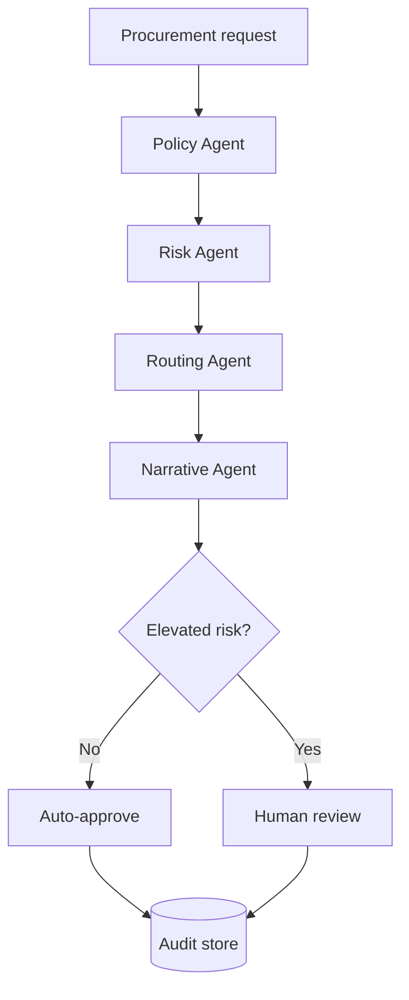

# ProcurePilot AI

[](.github/workflows/ci.yml)
[](pyproject.toml)
[](https://learn.microsoft.com/semantic-kernel/overview/)
[](LICENSE)

**Policy-aware agentic procurement automation with explicit controls, human approval and an auditable execution trace.**

ProcurePilot AI turns an unstructured purchase request into decision support. Four bounded agents
retrieve relevant policy, identify risk, determine the required approval route and generate a grounded
executive explanation. Low-risk requests can be auto-approved; every elevated-risk request stops for
human review.

The project is designed as a realistic portfolio implementation of **Agentic AI + Business
Automation**. It runs locally without cloud credentials and can switch to **Azure OpenAI through
Microsoft Semantic Kernel** for its language-model step.

## Why this project exists

Enterprise AI is not only about producing fluent output. A useful system also needs predictable
control flow, policy grounding, validation, auditability, monitoring and clear ownership of decisions.
ProcurePilot demonstrates those engineering concerns in one small, runnable system.

## Capabilities

- **Bounded multi-agent workflow:** Policy, Risk, Routing and Narrative agents have separate contracts.
- **Retrieval-augmented generation:** Relevant sections are retrieved from versioned Markdown policies.
- **Azure-ready AI:** Optional Azure OpenAI integration via Semantic Kernel; deterministic mock mode by default.
- **Human-in-the-loop:** Medium- and high-risk requests cannot approve themselves.
- **Explainability:** Every result contains reasons, retrieved evidence and a timed execution trace.
- **Production-oriented API:** FastAPI, validation, health endpoint, OpenAPI and SQLite audit persistence.
- **Observability:** Prometheus metrics and optional OpenTelemetry OTLP traces.
- **Delivery automation:** Docker, GitHub Actions, Dependabot and Azure Bicep infrastructure.
- **Secure defaults:** Non-root container, read-only filesystem, bounded inputs and prompt-injection separation.
- **Microsoft integration path:** OpenAPI can be imported into Copilot Studio or Microsoft 365 Agents.

## Architecture



The LLM is intentionally **not** responsible for approval thresholds or routing. Those controls stay
deterministic and testable. See [the architecture document](docs/architecture.md) and
[ADR-001](docs/decisions/001-bounded-agents.md).

## Quick start

### Option 1: Docker

```bash
docker compose up --build
```

Open <http://localhost:8000>. No API key is required.

### Option 2: Local Python

```bash
python -m venv .venv

# Linux/macOS
source .venv/bin/activate

# Windows PowerShell
.venv\Scripts\Activate.ps1

python -m pip install -e ".[dev]"
uvicorn procurepilot.api:app --reload
```

Then open:

- Dashboard: <http://localhost:8000>
- OpenAPI: <http://localhost:8000/docs>
- Prometheus metrics: <http://localhost:8000/metrics>

## Run a demo request

```bash
python scripts/demo.py
```

Or call the API directly:

```bash
curl -X POST http://localhost:8000/api/v1/assessments \
  -H "Content-Type: application/json" \
  -d '{
    "requester": "Kadir Demir",
    "department": "Research & Development",
    "vendor": "Fabrikam Analytics Ltd",
    "amount_eur": 128000,
    "description": "Quality inspection service processing production images.",
    "data_classification": "restricted",
    "contains_personal_data": true,
    "single_source": true,
    "urgent": true
  }'
```

The response is `pending_review`, routes the request to the appropriate reviewers and records each
agent step. A reviewer can approve or reject it through:

```text
POST /api/v1/assessments/{id}/decision
```

## Use Azure OpenAI / Microsoft Foundry

Copy `.env.example` to `.env`, set the Azure values and change the provider:

```dotenv
AI_PROVIDER=azure
AZURE_OPENAI_ENDPOINT=https://YOUR-RESOURCE.openai.azure.com/
AZURE_OPENAI_API_KEY=...
AZURE_OPENAI_DEPLOYMENT=gpt-4.1-mini
```

Semantic Kernel supplies the Azure chat-completion adapter. The application passes retrieved policy
evidence to the narrative agent, marks user content as untrusted and limits the model to a concise
explanation. Threshold evaluation and approval routing remain outside the model.

For a real deployment, prefer Microsoft Entra ID and Key Vault over a long-lived API key. The Bicep
template in [`infra/main.bicep`](infra/main.bicep) provides an Azure Container Apps baseline and can
consume an existing model deployment.

## Quality gates

```bash
pytest
ruff check .
ruff format --check .
mypy src/procurepilot
bandit -c pyproject.toml -r src
docker build .
```

GitHub Actions executes the same checks for every push and pull request. Tests cover approval
thresholds, data-handling risk, single-source exceptions, API validation, persistence and human review.

## Repository map

```text
src/procurepilot/   API, agents, retrieval, workflow, persistence and telemetry
policies/           Version-controlled business policy used for retrieval
tests/              Unit and API tests
infra/              Azure Bicep deployment baseline
docs/               Architecture, threat model, ADR and Microsoft integration guide
.github/             CI and dependency updates
```

## Design boundaries

This is a portfolio demonstration, not a purchasing or legal decision engine. The included policy is
fictional. Production use would require identity and role-based access, encrypted managed storage,
enterprise search, policy ownership, evaluation against representative cases and organisation-specific
governance.

## Further documentation

- [Architecture and extension points](docs/architecture.md)
- [Threat model](docs/threat-model.md)
- [Copilot Studio / Microsoft 365 Agents integration](docs/microsoft-integration.md)
- [Five-minute interview demo](docs/demo-script.md)
- [Security policy](SECURITY.md)
- [Contributing](CONTRIBUTING.md)

## Author

**Kadir Demir** — Software Engineer and M.Sc. Artificial Intelligence candidate at Johannes Kepler
University Linz.

## License

[MIT](LICENSE)

