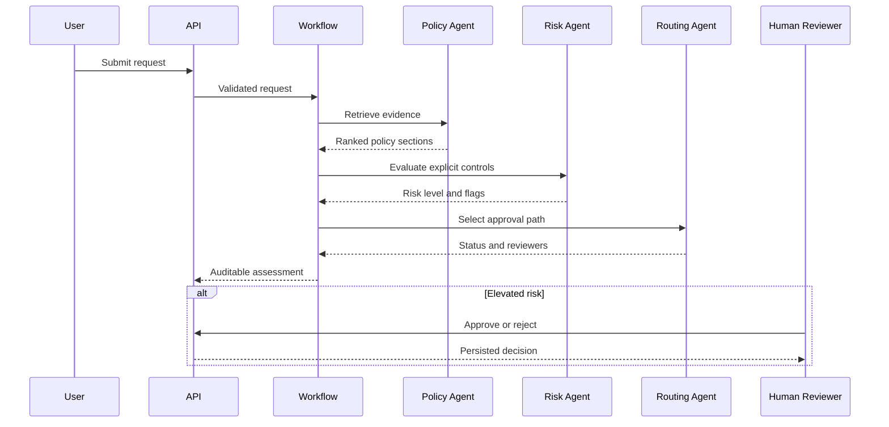

# Architecture

## Context

Procurement automation is a useful example of an AI-enabled business process because it combines
unstructured input, policy retrieval, deterministic controls and accountable human decisions. The
system separates these concerns instead of asking one model to make an opaque end-to-end decision.

## Components

| Component | Responsibility | AI-dependent? |
| --- | --- | --- |
| FastAPI | Validation, REST API, OpenAPI and static dashboard | No |
| Policy Agent | Retrieve the most relevant versioned policy sections | No |
| Risk Agent | Apply explicit thresholds and data-handling controls | No |
| Routing Agent | Select approvers and enforce human review | No |
| Narrative Agent | Produce a concise, policy-grounded explanation | Optional |
| Repository | Persist request, evidence, trace and reviewer decision | No |
| Telemetry | Prometheus metrics and OpenTelemetry traces | No |

## Request sequence

## Why deterministic orchestration?

The workflow order, stopping rule and approval thresholds are code, not model output. This makes
the most important controls reproducible and unit-testable. The model adds value where language is
helpful: converting structured findings and retrieved evidence into a concise explanation.

## Retrieval

The local implementation uses transparent lexical ranking over Markdown sections. It keeps the demo
small and offline. `PolicyRetriever` exposes a narrow contract, so Azure AI Search, PostgreSQL with
pgvector or another retriever can replace it without modifying the agents.

## Production evolution

1. Replace local policy files with a governed document source and enterprise retrieval service.
2. Use Microsoft Entra ID, managed identities and role-based authorisation.
3. Move the audit store to PostgreSQL or Cosmos DB with encryption and retention controls.
4. Add an evaluation corpus covering retrieval quality, routing accuracy and explanation groundedness.
5. Add model-content safety checks and organisation-specific policy governance.
6. Connect approval actions to a workflow platform such as Power Automate.

